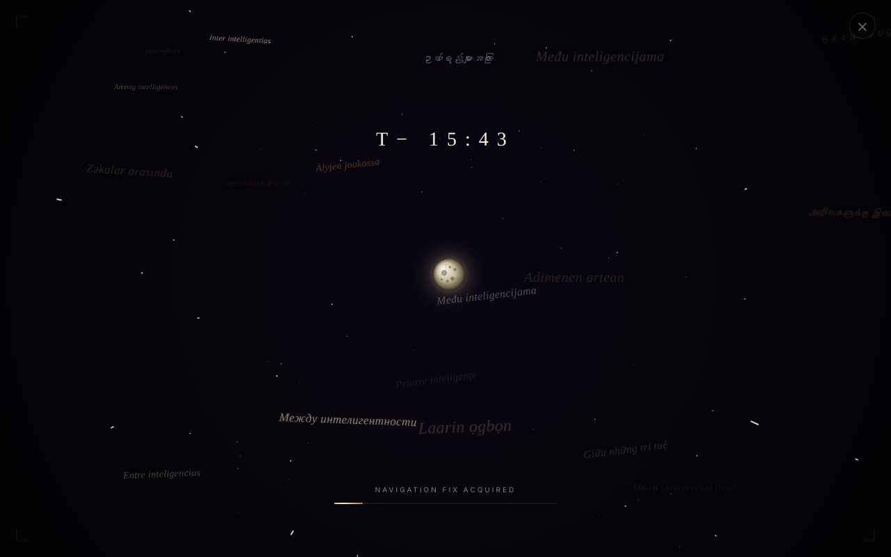

# Printre inteligențe

[English](README.md) · [Română](README.ro.md) · [Français](README.fr.md) · [Italiano](README.it.md) · [Español](README.es.md) · **Português** · [Deutsch](README.de.md) · [Magyar](README.hu.md)

**Versão:** 1.1.0 · **Última atualização:** 2026-10-14

Romance de ficção científica interativo sobre a missão Artemis 2, «criticado pelas estrelas e pelas hipercivilizações», com audiolivro integrado.

**Online:** https://chiuta.github.io/PrintreInteligente/

## O que é

«Printre inteligențe» é um livro vivo, publicado como aplicação web (um grande ficheiro `index.html`, mais `sw.js`, `robots.txt`, `sitemap.xml` e imagens de pré-visualização). O romance, inspirado na missão Artemis 2 da NASA (voo de teste lunar, concluído a 10 de abril de 2026), coloca a tripulação num cenário inteiramente fictício, em que uma avaria técnica a obriga a uma alunagem de emergência. Segundo a página, o livro contém um Prólogo, dois capítulos, um Epílogo, 17 cenários alternativos agrupados em 5 famílias e 108 críticas fictícias em 12 categorias (literárias, filosóficas, de leitores, de IA do futuro, NHI, hipercivilizações etc.). A página declara que é uma obra de ficção, não afiliada à NASA nem à CSA, e que é uma colaboração humano-IA, revelada no Epílogo.

## Funcionalidades

- Navegação por secções (menu lateral): livro, cenários, críticas.
- Audiolivro integrado, com síntese de voz (serviço online ou voz local do navegador), definições de vozes e de reprodução.
- Funcionalidades generativas «✨ A tua crítica» e «🚀 O teu final», que chamam uma API de IA através de um endpoint configurável (`/api/claude`).
- Pesquisa, tema dia/noite, modo de leitura, fundos e efeitos sonoros opcionais, progresso de leitura e marcadores.
- Tradução automática da página, à escolha, para uma longa lista de idiomas (menu «Traduções»; o idioma original é o romeno).
- Painel de atalhos de teclado (chamado com `?`).
- Páginas legais na aplicação: privacidade/RGPD, cookies, botão «Eliminar todos os dados locais».
- PWA: manifesto e Service Worker (`sw.js`).

## Manual de utilização

Atalhos apresentados pela aplicação:

- `← →` página anterior / seguinte; `↑ ↓` deslocação
- `Esc` fecha qualquer janela modal ou painel
- `/` ou `Ctrl+F` abre a pesquisa
- `H` início; `D` alterna o tema dia/noite
- `A` abre o audiolivro; `Espaço` reproduzir/pausa do audiolivro
- `?` mostra a lista de atalhos

Passos:

1. Leia a partir do menu lateral: Prólogo, Capítulos 1-2, cenários, críticas, Epílogo.
2. Para o audiolivro carregue em `A` e use Reproduzir/Pausa.
3. Para outro idioma abra o menu «Traduções» e escolha o idioma.
4. «✨ A tua crítica» e «🚀 O teu final» enviam o teu texto a uma API de IA apenas quando atuas (e confirmas).
5. Os dados locais podem ser eliminados com «🗑️ Eliminar agora todos os dados locais» na página de cookies/privacidade.

## Privacidade e rede

Local (`localStorage`/`sessionStorage`), conforme a página de cookies da aplicação: preferências visuais e de áudio (`bgfxMode`, `bgfxActive`, `moonMode`, `rdMode`, `sfx_prefs`, `ab_voice_prefs` etc.), progresso e marcadores (`pi-progress`, `pi-bookmarks`), críticas e finais próprios (`pi-reviews`, `pi-endings`, `c108entries`), confirmação do aviso legal, e `nlSubs` (os endereços introduzidos no formulário da newsletter são apenas guardados localmente por este código).

Anfitriões de terceiros contactados:

- `alexio.tf`: imagens ilustrativas (pedidas no carregamento; o único pedido externo sem ação do utilizador) e pré-visualizações de partilha.
- `tts-proxy.chiuta.workers.dev` (Cloudflare Worker para o Azure Neural TTS): **apenas se assinalares explicitamente** «Voz online Azure Neural» no painel de vozes do audiolivro (opt-in, desativado por omissão; a preferência fica guardada em `pi_azure_tts`); nesse caso é feito um pedido de teste e o texto lido segue para o proxy para síntese; sem opt-in usa-se a voz local do navegador e no carregamento não segue nenhum pedido para este serviço.
- `translate.googleapis.com`: apenas se escolheres outro idioma em «Traduções»; o texto da página é enviado ao Google Translate.
- Uma API de IA através de `/api/claude` (o proxy `claude-proxy.worker.js` do repositório, para a API da Anthropic): apenas se usares «A tua crítica» / «O teu final».
- Google Fonts: verificado na auditoria (2026-10-10) — não existe nenhum pedido a `fonts.googleapis.com` / `fonts.gstatic.com`; a página de privacidade só os menciona de forma condicional.
- O formulário «Próxima história» (newsletter): o endereço de e-mail é guardado apenas localmente, em `localStorage` (`nlSubs`); não é enviado para lado nenhum e ninguém receberá notificações com base nele, embora a mensagem de confirmação diga «Aviso-te quando aparecer algo novo».

A página alojada no GitHub Pages não tem a rota `/api/claude`, pelo que as funcionalidades generativas provavelmente não respondem aí, a menos que `window.PI_API_ENDPOINT` esteja configurado.

## Aviso

Ficção / especulação: o romance, os cenários e as 108 críticas são obras de ficção; as críticas são fictícias e os valores de «leitores ativos» são simulados (assinalados «~simulado» na página). A história usa os nomes reais dos membros da tripulação da Artemis 2 (Koch, Wiseman, Glover, Hansen) como personagens num cenário inteiramente imaginário; não é afiliada à NASA, à CSA, à ESA nem à tripulação. Os textos gerados através de «A tua crítica» / «O teu final» são produzidos por um modelo de IA e podem conter erros.

## Execução local / offline

Transfira o repositório e abra `index.html`: o texto do livro está incluído no ficheiro e lê-se sem internet. Precisam de internet: o audiolivro com voz online (opcional; caso contrário, a voz local), as traduções, as funcionalidades generativas e as imagens de alexio.tf. O Service Worker regista-se no caminho `/sw.js` e só funciona em http(s), não a partir de um ficheiro local.

## Licença

MIT — veja o ficheiro [LICENSE](LICENSE). Os direitos de autor são mantidos; o código e o texto do livro podem ser usados, copiados, modificados e redistribuídos mantendo o aviso de licença.

## Novidades (v1.1.0)

- **Marcadores e notas em passagens** (botão 📝 da barra superior): seleciona um fragmento de uma página (livro, cenários, críticas) e acrescenta uma nota; fica guardada apenas no navegador (FFF.store), «Ir para o fragmento» leva-te à página e ao parágrafo em causa, as notas podem ser eliminadas e exportadas como Markdown. São independentes dos marcadores existentes (`pi-bookmarks`), que não mudam.
- **Cópia de segurança .fff.json** através da etiqueta «Transparência» (clique em `v 1.1.0 · 2026-10-14` em «Termos e privacidade»): exporta/importa (opcionalmente cifrados com palavra-passe) o progresso, os marcadores, as notas e as críticas próprias; mostra as chaves armazenadas e a rede declarada.
- Kit comum (core, label, bundle). A pesquisa (Ctrl+K), o audiolivro e a tradução existentes não foram modificados. Cache do Service Worker: pi-v15.
- Os textos novos estão em ro, en, fr, it, es, pt, hu, de; as traduções fr/it/es/pt/hu/de são automáticas e não verificadas por nativos.
- Testes: `tests/fff-r8.test.mjs` (rede bloqueada; as imagens de alexio.tf, pedidas também antes, são excluídas da contagem; 1280 e 360 px, axe 0 violações com a caixa de diálogo aberta).

## Histórico / Changelog

### 1.1.0 — 2026-10-14
- Novo: marcadores e notas em passagens com exportação para Markdown; cópia de segurança .fff.json e etiqueta de transparência (kit comum). Cache SW pi-v15.

### 1.0.0 — 2026-10-12
- A versão e a data da última atualização são mostradas na aplicação (janela «Termos e privacidade»).

### 11 de outubro de 2026 (ronda 7)
- Corrigido: os grupos recolhidos do menu lateral (O LIVRO, CENÁRIOS, AÇÕES etc.) escondiam as ligações apenas visualmente (`max-height:0`); estas permaneciam na ordem do Tab e por baixo dos elementos vizinhos (clique real intercetado pelos títulos dos grupos). Agora os grupos recolhidos são `visibility:hidden` (com transição), pelo que já não podem receber o foco nem ser lidos pelos leitores de ecrã. Verificado: clique real em «Prólogo» depois de abrir o grupo, 0 violações axe-core. Cache do Service Worker: pi-v14.
- Corrigido: na vista de leitura, o painel do audiolivro, a faixa «Disclaimer & Termos» e a notificação «Novidades» não estavam em nenhum ponto de referência ARIA (axe-core `region`); agora têm `role="region"`/`role="status"`.

### 11 de outubro de 2026 (ronda 6)
- Corrigido: os 354 manipuladores em linha (`onclick`, `onchange` etc.) foram substituídos por um despachante delegado (`data-on-*` + um único listener, sem eval/Function; os argumentos dinâmicos passam por uma lista branca de funções). Paridade verificada em 495 elementos (0 diferenças). A CSP tem agora `script-src` com 16 hashes sha256, sem `'unsafe-inline'`.

### 11 de outubro de 2026
- Atualizado: a missão real Artemis 2 já não é descrita como «programada»: voo de teste em torno da Lua, lançado em abril de 2026, amaragem no Pacífico a 10 de abril de 2026 (tripulação Wiseman, Glover, Koch, Hansen). Fontes verificadas a 11.10.2026: NBC Palm Springs (10.04.2026), NASA. O texto fictício do romance não foi modificado.
- Corrigido: a introdução cinematográfica pode ser fechada com o teclado (o botão × é agora um `<button>`, mais a tecla Escape); a duração de 18,35 s da introdução continua a ser uma decisão artística do autor.
- Corrigido: as imagens do livro (servidas a partir de alexio.tf) têm um substituto com o texto alternativo quando falta a rede, em vez de um ícone partido.
- Corrigido: as janelas/sobreposições fechadas já não permanecem focáveis (visibility:hidden); `<footer>`, elementos decorativos `aria-hidden`, sem `tabindex` positivo; 0 violações axe-core a 1280 e 360 px.
- Adicionado: política CSP (meta) com os anfitriões declarados (alexio.tf, translate.googleapis.com, tts-proxy.chiuta.workers.dev, claude-proxy.alexio.workers.dev); cache do Service Worker pi-v12 (agora pi-v13).
- Inalterado: o contador «a ler agora» continua simulado e rotulado como tal; a licença/os direitos de autor não foram modificados (decisão do autor).

## Autor

Alexio — Alexandru-Ionuț Chiuță, contacto: alexio@trom.tf

## English summary

"Printre inteligențe" is an interactive Romanian-language SF novel built around the NASA Artemis 2 mission, published as a web app: prologue, chapters, epilogue, 17 alternate scenarios and 108 fictional reviews, with an integrated audiobook. It stores preferences, reading progress and user texts in localStorage. It contacts alexio.tf (images), a TTS proxy on Cloudflare Workers, Google Translate (only if you pick a language) and an AI API endpoint (only for the generative features). Licence: MIT.

## Auditoria

Ronda 2 (2026-10-11): o pedido de teste ao proxy TTS no carregamento foi substituído por um opt-in explícito no painel de vozes; as formulações «offline / sem telemetria / funciona integralmente no navegador» no cabeçalho, nas FAQ, na página de privacidade e no resumo EN foram precisadas (o texto do livro lê-se offline; as imagens, a voz online, a tradução e as funcionalidades de IA usam serviços externos); a nota de ficção sobre os nomes reais dos membros da tripulação foi completada na página (RO e EN). Licença: MIT.

Auditoria: 2026-10-10 — as afirmações de rede deste README correspondem ao código (fetch para `tts-proxy.chiuta.workers.dev` — incluindo um pedido de teste no carregamento —, `translate.googleapis.com`, `window.PI_API_ENDPOINT`; imagens de `alexio.tf`). O cabeçalho da aplicação diz «offline-first, sem telemetria», e a página contém formulações absolutas («funciona integralmente no navegador», no resumo em inglês) que não têm em conta estas chamadas; a licença foi depois estabelecida como MIT. Acessibilidade corrigida (contraste em todos os temas, etiquetas nos campos de seleção).
